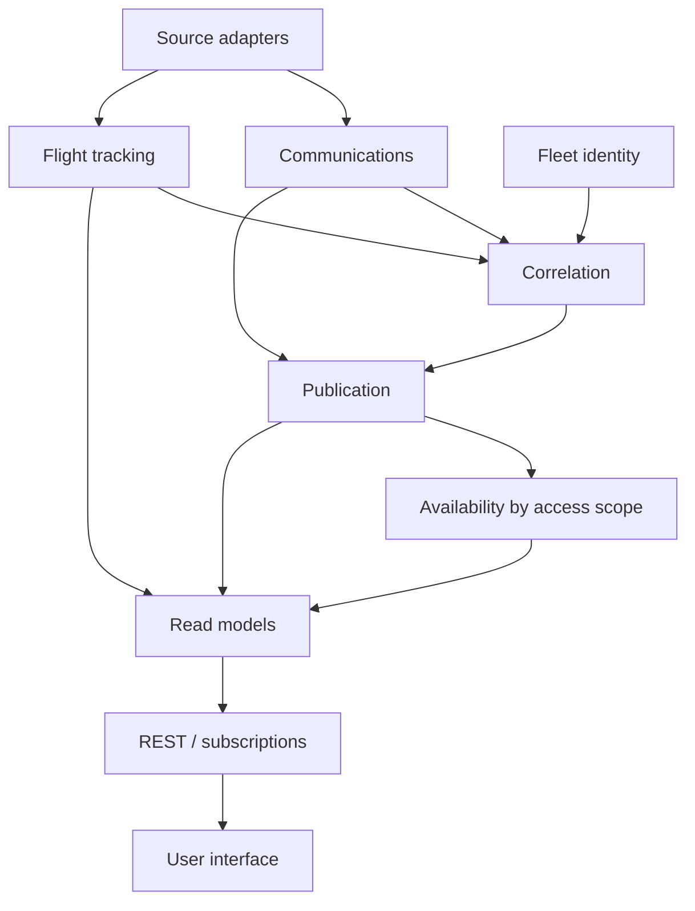

# Airframes Tracker — architecture v2

**Date:** 18 November 2026. **Status:** an architecture proposal and reference implementation of selected rules; not a production-ready platform.
**Continuation:** the v1 architecture and HTML mockup agreed in this conversation.
**Priorities:** SRP, explicit invariants, small modules, composition, controlled dependencies, and the ability to revise earlier decisions.

## 1. Guiding decision

We retain a modular monolith in TypeScript. We increase granularity **within** domain boundaries: separate value types, rules, use cases, ports, and adapters. This does not automatically increase the number of services, queues, or npm packages. Process separation is driven by measured runtime requirements.

We use five structural levels:

1. **Bounded context:** the owner of a specific model, language, and rules; for example, aviation communications.
2. **Responsibility module:** a cohesive capability within a context; for example, message fragment reassembly.
3. **Use case:** a specific intent; for example, `AcceptMessageFragment`.
4. **Pure rule / value type:** one decision or invariant; for example, `isWithinAssemblyWindow`.
5. **Adapter:** one connection to the outside world; for example, persisting an assembly session in PostgreSQL.

SRP means a shared reason to change, rather than a requirement for one class per statement. Changes to a provider's format, the matching policy, and the persistence mechanism have different owners, so they belong in different files. The division into bounded contexts and this interpretation of SRP are based on [S1] and [S2].

### Specific improvements over v1

| v1 problem | v2 decision | Effect on the code |
|---|---|---|
| Domains, projections, and transport were all called equivalent micro-domains | Separate business areas, application read models, and platform capabilities | Each rule has an unambiguous owner |
| `FlightCandidate` was required for every match | Separate `AircraftLinkDecision` and `FlightLinkDecision` | A message can be assigned to an aircraft without a known flight session |
| `canonicalKey` suggested globally removing similar messages | Three distinct mechanisms: delivery idempotency, reception grouping, and message equivalence | A subsequent real transmission is retained even when its text is identical |
| `Frame`, reception, and decoded content had overlapping meanings | `SourceDelivery`, `Reception`, `FrameOccurrence`, `MessageRevision` | Preserve provenance and the interpretation version |
| One bearer and one protocol in a flattened object | A versioned protocol tree/stack and communication direction | VDL2 is not automatically treated as ACARS |
| A decision contained many nullable IDs | Disjoint result variants | A `MATCHED` result without an `AircraftId` cannot be constructed through the normal type model |
| Last-seen updates relied solely on `max()` | A register of active message contributions and retractions | Reassigning a message from A→B corrects the status of both aircraft |
| The expiry scheduler had no protection against stale work | `expectedRevision`, a durable deadline, and recomputation | An old timer cannot expire a fresh message |
| Content was filtered, but status and counts could use global data | Contributions and projections are restricted to the authorized recipient | The existence of an inaccessible message is not disclosed |
| REST snapshots and WS updates had no synchronization barrier | Snapshot + generation + cursor from the same projection | No silent gap when a subscription starts |
| The outbox was treated almost like a broker | Separate fan-out, delivery, and consumer inbox responsibilities | Each consumer has durable, independent delivery state |

## 2. Eight owners of domain rules

These are larger boundaries containing many small modules. Integrations, read models, and WebSocket remain separate technical areas.

| Context | Model ownership | Outside this context |
|---|---|---|
| `fleet-identity` | AircraftId, ICAO24/registration aliases, their validity periods, and provenance | The current flight and the message assignment algorithm |
| `flight-tracking` | Position observations, tracks, flight segments, and current position | Communication content and frame status |
| `communications` | Data deliveries, receptions, frames, reassembly, and message revisions | Deciding which known aircraft a message belongs to |
| `correlation` | Evidence and versioned Message→Aircraft and Message→Flight decisions | Radio decoding, map colors, and SQL belonging to other contexts |
| `availability` | Message contributions to reception status and their expiry | Assessing sources through map heuristics or changing identity |
| `receiver-network` | Stations, receiver installations, capabilities, heartbeat, and location | Managing user passwords and provider secrets |
| `publication` | Permitted fields, authorized data scope, policy revision, and withdrawal | Identifying users and handling login |
| `access` | Principal, roles/permissions, station tokens, and access validity | Message content and aviation publication rules |

Technical areas:

- `source-connectors`: provider connections, input schemas, retries, limits, and declarations of feed capabilities and completeness;
- `read-models`: map, flight-list, message-timeline, station-list, search; projections belong to the application, not the HTTP adapter;
- `delivery`: subscriptions, initial synchronization, deltas, removing objects from the viewport, and backpressure;
- `platform`: outbox, durable dispatch, inbox, migrations, monitoring, clock, identifiers, and object storage for payloads.

**Transaction boundaries do not follow individual file boundaries.** Recording a reception and assigning it to a frame occurrence may require one transaction in `communications`, even when separate small components handle these steps. Splitting that operation across services would remove the required atomicity.

## 3. Dependency map



An arrow represents a flow of published facts or an explicit read contract. It does not grant permission to import an implementation or access another context's tables. `access` and `receiver-network` support the relevant inputs; neither is a central service invoked by every pure rule.

### Dependencies within a context

`transport adapter → application use case → domain function`. The use case declares a port, and an infrastructure adapter implements it. The composition root assembles the components. The domain does not import Fastify, React, Kysely, Redis, a provider SDK, or the system clock.

Synchronous queries through public interfaces are allowed if they do not create cycles or bypass data ownership. Changes between contexts propagate through durable facts. A local method call's speed does not remove architectural boundaries.

## 4. Data vocabulary: concepts that must remain distinct

### 4.1 Aircraft and flight

- `AircraftId`: a stable internal identifier; it is not an ICAO24 string.
- `AircraftIdentityAssertion`: a source's assertion about an identifier, with a validity period and recording time.
- `PositionObservation`: a position fact with its observation time, source, and measurement type.
- `FlightSession`: a hypothesis about a specific flight leg, with a history of assignment changes.
- `ObservedTrack`: a collection of positions actually received. It is not a planned route.
- `PlannedRoute` / `ScheduledService`: optional, separate data; their absence does not justify guessing a destination from the aircraft's heading.

The alias register distinguishes `validFrom/validUntil` from `recordedAt/supersededAt`. A fully bitemporal database is not required from the outset, but history relevant to correlation must not be overwritten. A current alias may not be valid for an old reception.

### 4.2 Delivery, reception, frame, and message

| Model | Identity and meaning |
|---|---|
| `SourceDelivery` | A specific delivery of data to an integration; the provider may repeat it after reconnecting |
| `Reception` | A known reception by a specific receiver/station; multiple deliveries may report the same reception |
| `FrameOccurrence` | A hypothesis about one frame transmission observed by multiple receivers |
| `FrameObservation` | An interpretation of one frame observation: payload, quality, direction, and decoding result |
| `AssemblySession` | Controlled state for assembling fragments of one message |
| `LogicalMessage` | An application message that may be assembled from several fragments |
| `MessageRevision` | An immutable version of decoded content, with the decoder version and references to evidence |

Not every provider exposes all these levels. When we receive a complete `Message`, we record a `ProviderMessageObservation` with its provenance. **We do not fabricate a frame or station** to fill the schema. `dataLevel` describes the actual level of data, and an absent raw payload remains explicitly absent.

Reassembly requires fragment identification, ordering, and timeouts; these capabilities are described in the libacars documentation [S3]. Existing VDL2 decoders support more than ACARS [S4]. We use adapters to existing decoders, without implementing a radio demodulator in the web application layer.

### 4.3 Protocol as a structure

We store `bearer`, `protocolStack`, and `direction`. Direction values are `AIR_TO_GROUND`, `GROUND_TO_AIR`, and `UNKNOWN`. The sender's identity is not automatically the aircraft's identity: an uplink message may be addressed to the aircraft. The parser extracts address roles, and the correlator uses the appropriate participant.

We do not introduce a global enum that forces the entire system to be rebuilt for every new radio application. The core has stable categories, and the parser registry has versioned extensions; an unknown protocol branch is not arbitrary `any`.

## 5. Communications: separation by actual reasons to change

The flow of a single delivery:

1. `ValidateEnvelope`: size, schema, and required metadata.
2. `ClassifyInputLevel`: raw frame, fragment, or complete provider message.
3. `NormalizeObservationTime`: time, units, time source, and clock tolerance.
4. `ExtractSourceIdentity`: source, account, receiver, decoder, and version.
5. `CheckDeliveryIdentity`: whether the same delivery has already been accepted.
6. `AppendReceptionFact`: record an independent reception if the provider actually confirms it.
7. `FindFrameOccurrenceCandidates`: search for a similar transmission within a bounded window.
8. `EvaluateFrameEquivalence`: consistency of addresses, sequence, frequency, direction, and time.
9. `AssignFrameOccurrence`: a separate, versioned decision; retain the original receptions.
10. `DecodeFrame` or `ImportDecodedMessage`: two different input paths.
11. `SelectAssemblyKey`: protocol and sequence context, rather than just a text hash.
12. `AcceptFragment` / `ExpireAssembly`: fragment state, missing elements, and deadline.
13. `FinalizeMessageRevision`: a version of the result with references to its inputs.
14. `CommitCommunicationFacts`: data and outbox are atomic within the given use case.

This is a catalog of responsibilities, not a list of 14 brokers and 14 network calls. Independent small functions can be composed within one process and one transaction. The detailed catalog is in `docs/MODULE_CATALOG.md`.

### Three distinct meanings of duplicate

**Repeated delivery:** the same `(source, account, stableExternalId)`, provided the contract confirms ID stability. The key includes the provider scope, session, or receiver when identifiers may be reused. A conflicting payload under the same key is an error requiring investigation.

**Multiple receptions of one transmission:** three receivers hear the same frame. We retain three `Reception` records, create one `FrameOccurrence`, and create three links. A fingerprint key retrieves candidates; it does not guarantee equivalence.

**Similar messages:** two messages have identical text but different times or sequences. By default, they are separate facts. Retransmission, repeated ACKs, and reassembly follow protocol-specific rules. Grouping by text alone can destroy history.

Deduplication windows cannot depend solely on `floor(timestamp / interval)`: receptions of the same event may fall on opposite sides of an interval boundary. We search adjacent buckets and evaluate the actual time difference. A get-or-create operation requires protection against concurrent creation of two occurrences; the DB adapter enforces uniqueness for safe keys or locks the appropriate shard.

## 6. Correlation: two processes instead of one large service

### 6.1 Message → Aircraft

The `ResolveMessageAircraft` use case accepts a message identifier and revision, retrieves permitted facts, extracts normalized hints, and retrieves candidates from the local identity projection. A missing flight session does not block this stage.

Small rules:

- `ValidateIcao24`: address format and semantics, without casting an arbitrary string;
- `NormalizeRegistration`: retains both the original and normalized values; it does not arbitrarily remove characters;
- `SelectAircraftAddressRole`: identifies the aircraft address in uplink/downlink traffic;
- `ResolveIdentityAtObservationTime`: selects the alias valid at observation time;
- `CollectExactIcaoEvidence` and `CollectRegistrationEvidence`: independent evidence;
- `DetectStrongIdentifierConflict`: strong contradictions cannot be offset by other scores;
- `ResolveCandidateUniqueness`: two equally good candidates produce `AMBIGUOUS`;
- `DecideAircraftLink`: an explicit decision policy, without presenting a sum of weights as a confidence percentage;
- `BuildLinkRevision`: records input revisions, policyVersion, evidence, and the previous decision's identifier.

The result has `MATCHED`, `AMBIGUOUS`, `CONFLICTED`, and `UNMATCHED` variants. An incomplete candidate sample that is not marked as such cannot establish uniqueness. `CandidateSet` includes index completeness and a checkpoint; a timeout or an index that is not ready is an error/retry condition, not `UNMATCHED`.

### 6.2 Message → FlightSession

A separate use case, `ResolveMessageFlight`, uses the accepted aircraft match and the observation window. Its rules check:

1. Whether the session belongs to the aircraft already identified.
2. Whether the valid flight window intersects the message's reliable time interval.
3. Whether the callsign matches that session and has not been normalized through guesswork.
4. Whether there is another competing session.
5. Whether time quality is sufficient for a precise assignment.

A valid state can be `aircraft = MATCHED`, `flight = UNMATCHED`. The UI shows the message against the aircraft without adding a false flight number. A "no match" state and a provider failure must remain distinct.

### 6.3 Rationale and revisions

Each decision stores `messageRevision`, `identityIndexRevision`, `policyVersion`, accepted and rejected evidence, and the decision time. Re-evaluation emits a new revision and information about the previous assignment. We do not overwrite the previous decision's audit trail.

The correlator does not assemble fragments, send WebSocket messages, or calculate a green status dot. It can be thoroughly tested on data without running a database.

## 7. Availability: status derived from reversible contributions

Using only `lastMessageAt = max(lastMessageAt, eventTime)` is insufficient. After discovering that the latest message belonged to another aircraft, we need the earlier valid message.

We introduce `MessageContribution`:

- key `(visibilityScope, messageId)`;
- its own monotonic `contributionRevision`, assigned by the owner of the published contribution;
- `aircraftId`, optionally flightSessionId;
- bearer / applicationProtocol;
- the appropriate event time and its reliability;
- an active state or a tombstone with a revision.

Operations:

`assignmentRevision`, `messageRevision`, and the grant revision are independent inputs to the contribution producer. We neither compare them numerically nor take their maximum. The producer serializes changes for a given `(scope,messageId)` and assigns a separate `contributionRevision` order; this prevents a later grant revocation from being rejected as "older" than an assignment with a higher number.

- `ApplyContribution`: a new permitted message adds a contribution;
- `ReplaceContribution`: a revision moves a contribution from A to B and withdraws the previous one;
- `WithdrawContribution`: a decision or policy removes a contribution;
- `SelectLatestEligibleContribution`: selects the maximum among active contributions matching the filter;
- `ComputeFreshness`: calculates status from time and policy;
- `ScheduleNextTransition`: determines the exact next deadline;
- `ExpireAvailability`: checks expectedRevision and recalculates status;
- `RepairAvailability`: repairs the projection from facts after a failure or policy change.

A tombstone prevents a late, older revision from restoring a withdrawn contribution. Its retention must cover the entire supported redelivery/replay horizon; shortening its retention requires a new projection generation and a full rebuild.

### Four independent dimensions

| Dimension | Example values | What the UI displays |
|---|---|---|
| Message freshness | `RECENT / STALE / NONE` | Status color and last timestamp |
| Match | `MATCHED / AMBIGUOUS / CONFLICTED / UNMATCHED` | Evidence description or an uncertainty warning |
| Feed characteristics | `SAMPLED / STATION_SCOPED / UNKNOWN` | Known observation scope |
| Feed health | `HEALTHY / DEGRADED / DISCONNECTED` | A data reception problem |

Separate state describes position quality (`fresh/stale/unknown`) and how the position was determined. Fresh communication does not refresh an old ADS-B position. "Partial" must not simultaneously mean an incomplete message, a sampled feed, and a weak match.

For the demonstration, we use half-open intervals: `RECENT` for age `[0,10 min)`, `STALE` for `[10,60 min)`, and `NONE` from 60 min onward. The versioned policy records the exact boundaries. This is a design decision, not a property of the protocols.

**Backfill time:** a message observed at 10:00 and imported at 12:00 does not become fresh at 12:00. `TimeEvidence` distinguishes `observedAt`, `receiverAt`, `providerAt`, and `ingestedAt`; the adapter specifies the time basis and uncertainty. A missing observation time does not justify substituting `now` without marking that substitution. Timestamps too far in the future are sent for quality checks.

Airframes distinguishes a sampled global stream from a feed of the user's own stations [S5]. A complete feed from one station does not imply complete coverage of an aircraft or region. We do not calculate coverage percentages from frame counts alone.

## 8. Publication before public status and delivery

The unit of authorization is `VisibilityScope` (for example, a public collection, a specific station owner, or an authorized group), together with a policy version. RBAC and source access rights have distinct roles: a logged-in user is not automatically entitled to every feed.

`publication` emits the permitted data variant and a versioned grant/contribution. The public map, public counts, and public activity use only this variant. Hidden message counts or freshness derived from data the recipient must not know about must not be published.

When access is revoked:

1. `PublicationGrantRevoked` changes the authoritative policy revision.
2. `availability` withdraws the relevant contributions.
3. Projections remove the message/count or create a new view version.
4. The gateway blocks delivery according to the new policy and invalidates the buffer and old cursors.
5. The client receives remove or `resync.required`.

Asynchronous projection updates can lag, so the projector alone is not the only authorization safeguard. Final reads and replay check the current scope/policyVersion. Data already delivered legitimately to a client cannot be "unread"; we change future access and views.

## 9. Transaction boundaries and reliability

### 9.1 What is atomic

| Operation | One transaction | After the transaction |
|---|---|---|
| Accepting a reception | delivery dedup + reception + frame link + outbox | independent decoding / reassembly |
| Recording a message revision | messageRevision + input references + outbox | correlation, publication |
| Changing a match | expectedRevision + decision + history + outbox | update authorized contributions |
| Consuming an event | consumer inbox + local effects + new outbox | ACK / mark delivery |
| Moving a contribution | old contribution + new contribution + status of A and B + expiry + outbox | publish changes for both aircraft |

The last operation remains local to the availability context and the given visibilityScope. If later sharding places A and B in different partitions, we do not promise distributed atomicity: we introduce versioned replace/tombstone operations, an intermediate state, and a reconciler; the preferred initial partitioning keeps this operation together.

### 9.2 Transaction port restricted to a use case

Instead of a global `UnitOfWork` exposing arbitrary tables, we introduce a transaction restricted to specific capabilities, such as `CorrelationCommitter`, which can write only the decision, its version, and events. The use case does not receive a raw SQL client. Generic mechanics can handle transactions, but the available operations remain typed and narrowly scoped.

We do not combine `saveDecision()` and `eventBus.publish()` as independent steps on the critical path. A failure between them must not lose information about the change. The outbox is written in the decision's transaction.

### 9.3 Outbox, dispatch, inbox

The first deployment can use PostgreSQL for durable queue processing. This requires:

- an immutable outbox record;
- durable fan-out that creates a delivery for each registered consumer;
- uniqueness of `(consumerId, eventId)`;
- claim/lease, attempt count, retry deadline, and error state;
- a consumer inbox written atomically with local effects;
- a backfill mechanism for a new consumer and event retention covering that horizon.

**We do not use an increasing ID alone as a safe commit checkpoint.** Two transactions may allocate IDs in one order and commit in the opposite order. The dispatcher searches all undelivered records, not just `id > lastSeen`.

`FOR UPDATE SKIP LOCKED` is useful for claiming work, but PostgreSQL notes that skipping locks provides an inconsistent view and is suitable for uses such as queues, rather than a general data snapshot [S6]. Claim transactions remain short; they do not encompass long network operations.

After JetStream is added, the transport provides durable deliveries, but the DB adapter must still be idempotent. ACK follows DB commit; a repeated eventId does not repeat effects. Broker deduplication does not automatically cover our database transaction [S7]. Debezium also describes the outbox pattern and the meaning of the aggregate key [S8].

### 9.4 Ordering and corrections

We do not promise a global order for all events. A monotonic `aggregateRevision` applies to a single aggregate/stream. We distinguish delta events, which require consecutive revisions and backfill for gaps, from full replacement state, which can safely replace an older version. A consumer does not guess which kind it has received.

`schemaVersion` describes the DTO shape; `aggregateRevision` describes change ordering; `policyVersion` identifies the algorithm; `projectionGeneration` identifies a view rebuild version. None of these values replaces another.

## 10. UI synchronization without a REST→WS gap

The subscription contract includes `subscriptionId`, `generation`, `cursor`, a filter fingerprint, visibilityScope, and policyVersion. Cursors are opaque to the client. We do not expose private event sequences as public counters.

Proposed protocol:

1. The client sends `subscribe.viewport` or `subscribe.aircraft`.
2. The gateway registers for changes and starts buffering for that scope.
3. It reads a snapshot and checkpoint of **the same versioned projection** in a consistent database view.
4. It sends `snapshot.begin`, records, and `snapshot.end(cursor=C, generation=G)`.
5. It replays only changes after C from the durable log/buffer, then switches to live updates.
6. After disconnection, the client resumes with C and G; expired retention, changed permissions, or a changed generation requires a new snapshot.

`MapProjectionWriter` writes the object change and its change-log entry atomically. In the MVP, log ordering is guaranteed by one writer / a serialized counter row for the projection shard, rather than by a SQL sequence alone. With shards, the cursor becomes a token covering a checkpoint vector or a stable, dedicated stream.

A delta has the kind `upsert`, `remove`, `replace`, or `resync.required`. An aircraft leaving the bbox requires `remove`. Changing filters creates a new subscription generation. The client ignores delayed updates from the previous generation.

Under overload, positions can be coalesced to the latest version for each aircraft; messages use durable pagination and a cursor, and overflow triggers resync. We do not turn an unbounded WS buffer into an accidental database.

## 11. Persistence and read models

| Owner | Main tables |
|---|---|
| fleet | aircraft, identity_assertions, alias_resolution_history |
| tracking | position_observations, current_position, session_revisions, session_observation_links |
| communications | source_deliveries, receptions, frame_occurrences, occurrence_links, assembly_sessions, message_revisions, message_inputs |
| correlation | aircraft_link_revisions, flight_link_revisions, current_message_links, candidate_index_checkpoint |
| publication | policy_revisions, message_visibility_grants, grant_revisions |
| availability | message_contributions, scope_aircraft_state, expiry_jobs, applied_revisions |
| receivers | stations, receiver_installations, capabilities, health_snapshots |
| application read | map_rows, map_change_log, message_timeline, station_cards, projection_generations |
| platform | context outbox, per-consumer inbox, deliveries, retries, quarantines |

Each context owns its migrations and schema. Foreign keys within a context can enforce invariants. Between contexts, we prefer identifiers and contracts, without cascading deletion of another context's data; a rare cross-context foreign key requires an ADR and deliberately limits future separation.

PostGIS handles spatial position filtering. `observedAt` and `receivedAt` are separate. An older position does not overwrite a newer one; equal timestamps have an explicit tie-breaker based on quality and source. Redis is an optional cache, not a condition for correctness or the sole history store.

Large payloads use immutable object storage, a reference + checksum + permissions + retention. Secrets and signed URLs do not appear in domain events. A reception fact remains linked to its actual source; replay does not change its time.

An example design for the key tables and transactions is in `persistence/REFERENCE_DDL.sql`. It has not been executed against a production database or covered by PostgreSQL integration tests; it is material for implementing adapters.

## 12. Repository granularity

Target structure:

```text
apps/
  api/                 # composition root for REST, auth, serialization
  ingest-worker/       # source connections and intake
  processing-worker/   # decode, correlation, projections, expiry
  web/                 # routing and UI composition
packages/
  fleet-identity/
  flight-tracking/
  communications/
  correlation/
  availability/
  receiver-network/
  publication/
  access/
  source-connectors/
  read-models/
  delivery/
  platform/
  kernel/
```

The API and worker processes can initially share one deployment artifact. A file does not automatically become an npm package. Package exports remain small, and internal modules have their own entry points.

Example excerpt:

```text
correlation/
  src/
    aircraft-link/
      domain/
        values/aircraft-link-decision.ts
        evidence/icao24-evidence.ts
        evidence/registration-evidence.ts
        policies/reject-conflicting-identifiers.ts
        policies/choose-unique-candidate.ts
      application/
        resolve-message-aircraft.ts
        reevaluate-aircraft-link.ts
        ports/candidate-reader.ts
        ports/correlation-committer.ts
      infrastructure/
        postgres/pg-candidate-reader.ts
        postgres/pg-correlation-committer.ts
      public/index.ts
    flight-link/
      domain/policies/is-within-session-window.ts
      application/resolve-message-flight.ts
      public/index.ts
    reconciliation/
      application/reprocess-identity-range.ts
      public/index.ts
  contracts/
    aircraft-link-revised.v1.ts
    flight-link-revised.v1.ts
  composition/create-correlation.ts
```

A use-case file contains the flow of one operation and passes dependencies to its steps. Orchestrating several steps does not by itself make it a "god class." A domain rule is usually a pure function. A class is justified when it owns state or a lifecycle, such as a connection, scheduler, or buffer.

## 13. Generics with limits

The shared `kernel` should remain small. It contains mechanisms independent of aviation, with stable semantics.

| Pattern | Use | Constraint |
|---|---|---|
| `Brand<T, Name>` | Distinguishing IDs and units | Every value passes through a parser/constructor; a brand does not validate at runtime |
| `Result<T, E>` | Expected rejections and invalid input | Do not turn every infrastructure failure into a domain `UNMATCHED` result |
| `Rule<Input, Evidence>` | Policies with identical evaluation semantics | Separate policies for aircraft, sessions, and deduplication |
| `Parser<Raw, Canonical, Error>` | Mapping a specific provider schema | Wire JSON is validated, rather than propagated everywhere as `unknown` |
| `EventEnvelope<Name, Payload>` | A known name is associated with a known payload | Runtime schema + versioning; a string + generic alone is insufficient |
| `Transaction<Capabilities>` | Atomic operations permitted to a given use case | No raw SQL in application code or access to the entire repository |
| `CursorPage<T>` | Pagination results | The cursor is tied to scope and filters, not a page count |
| `DataTable<Row>` | Shared table rendering | Frame rules and colors do not belong in a generic table |

We do not use `BaseService<T>`, a global `GenericRepository<T>.save()`, or a `shared/business` directory. Ports use domain verbs: `appendReception`, `commitLinkRevision`, `replaceContribution`. Minimal readers are acceptable when they actually preserve the same semantics.

The clock dependency is an argument/port. The domain does not use `Date.now()`. A timestamp has a parser, not just a cast. `schemaVersion`, `policyVersion`, and public message types are not imported from inside domain entities.

## 14. SOLID and enforceable boundaries

- **SRP:** one decision owner and reason to change; separate policy, orchestration, and I/O.
- **OCP:** add an adapter or parser through a registry; a new protocol's semantics still require a deliberate decision, not "plugin magic."
- **LSP:** all implementations of a port have identical semantics for absent results, errors, uniqueness, and atomicity. A test double cannot pretend to provide guarantees that the DB adapter does not offer.
- **ISP:** `CandidateReader` has no deletion methods; a commit port does not expose queries across all tables.
- **DIP:** the composition root injects dependencies; application code does not retrieve them from a global service locator.

In CI:

1. Strict TypeScript + `noUncheckedIndexedAccess`, `exactOptionalPropertyTypes`, `useUnknownInCatchVariables`.
2. No deep imports between contexts or modules; use public entry points.
3. No domain→application/infrastructure/framework dependencies.
4. No dependency cycles or uncontrolled dynamic imports.
5. Separate TS projects for web, backend, and contracts; project references support compilation boundaries but do not replace import rules [S9].
6. Contract tests for adapters, migrations, and wire-payload examples.

Review heuristic: a function significantly exceeding 40–60 lines, a module with many dependencies, or a file exceeding 200 lines calls for review. These are not mechanical prohibitions; splitting a cohesive rule into artificial classes can be worse.

## 15. Frontend: the same discipline, a separate presentation model

The mockup's consistent design system remains shared across the map, list, and panel. Feature code is divided into:

| Feature | Small responsibilities |
|---|---|
| aircraft-map | viewport, marker style, position layer, selected track, pointer interaction |
| aircraft-selection | selection ID and URL synchronization |
| message-timeline | pagination, message row, payload viewer, match description |
| frame-status | freshness color, coverage description, feed problem |
| flight-filters | filter model, URL validation, query serialization |
| realtime-session | handshake, generation, cursor, delta reducer, reconnect |
| receiver-stations | station list, health badge, sharing form |

Server data goes into one cache keyed by identifiers and scopes; the UI does not keep a second independent copy of the same flights in the map and table. Selection state can live in the URL. The map library has its own render state, but it does not become the source of business rules.

`applyMapDelta` is a pure reducer: it checks the generation and revision, applies upsert/remove, and preserves the selection even when the point is lost, showing "outside the viewport / no current position." API and WS use the same DTOs. Every status has a text label; color alone does not convey all the information.

## 16. Stack and deployment — retaining the direction

TypeScript, React + MapLibre, Fastify, PostgreSQL + PostGIS, manual dependency composition, and schema validation at inputs. Redis and NATS are optional adapters introduced after a need has been established. We do not add another framework just to separate files.

Initially, `api` and `worker` processes plus PostgreSQL are sufficient. The worker can have separate intake/correlation/projection/expiry task pools, with limits and budgets. Our own SDRs send data through an authenticated feeder adapter, rather than a shared DB client.

Splitting into separate services is justified when, for example, heavy decoding affects API latency or WebSocket fan-out needs independent scaling. At that point, the owner's contracts and data migrate together, rather than a random collection of classes using other contexts' tables.

## 17. Tests focused on risk

The full matrix is in `docs/FAILURE_MODES.md`. Key cases:

- known ICAO24, no session → Aircraft can be identified;
- callsign without a strong identifier → no false confirmed match;
- two matching aliases or conflicting strong evidence → ambiguity/conflict;
- an old alias does not match a new date; backfill checks the historical date;
- a repeated delivery does not duplicate a reception, but a different station is retained;
- identical text an hour later remains a separate transmission;
- a message is assembled from out-of-order fragments or expires while incomplete;
- the second match revision moves the latest message from A→B;
- an older event revision does not undo a tombstone;
- an old timer does not roll back a newer projection;
- 10 min and 60 min exactly match the declared boundaries;
- a crash after commit and before ACK does not duplicate the effect;
- the snapshot/stream gap does not lose a record;
- a permission change removes the payload, count, and status contribution;
- replay does not produce "new" fresh events solely because of a new ingestion time.

Unit tests cover rules, contract tests cover adapters, integration tests cover transactions/DB, and E2E tests cover the UI flow. Benchmarks and load tests have explicit parameters (region, aircraft count, position and frame rates, users), rather than a claim that the system "handles millions."

## 18. Plan for the next implementation

| Iteration | Scope | Completion evidence |
|---|---|---|
| A | Typed kernel, contracts, import boundaries, fixtures, reference rules | Repeatable tests without a feed |
| B | One position adapter and one communication data level | Persistence with actual provenance and time; retry control |
| C | Aircraft correlation + freshness with retractions | A verified sample set with no false matches in that set |
| D | Scope-aware map and message projection + snapshot/delta | Reconnect, filter changes, revocation, no gaps |
| E | FlightSession correlation, reassembly where needed | Consecutive flights remain distinct; revisions are reproducible |
| F | Stations, more providers, cache/broker/partitions | Measurements establish the need and confirm the benefit |

The reference code included in this iteration covers A and selected rules from C. It has no connection to real providers, HTTP server, ready-to-use SDR decoder, or PostgreSQL adapter. The complete list of checks performed and their limitations is in `VERIFICATION.md`.

## 19. Primary sources and the scope of claims

The module names, boundaries, thresholds, and synchronization protocols above are design proposals. The sources verify underlying principles and technology capabilities; they do not establish that this application is ready.

- **[S1]** Robert C. Martin, [The Single Responsibility Principle](https://blog.cleancoder.com/uncle-bob/2014/05/08/SingleReponsibilityPrinciple.html).
- **[S2]** Martin Fowler, [Bounded Context](https://martinfowler.com/bliki/BoundedContext.html).
- **[S3]** libacars, [API Reference — reassembly](https://github.com/szpajder/libacars/blob/master/doc/API_REFERENCE.md).
- **[S4]** dumpvdl2, [README and supported protocols](https://github.com/szpajder/dumpvdl2).
- **[S5]** Airframes, [Realtime / Streaming](https://docs.airframes.io/api/realtime/).
- **[S6]** PostgreSQL, [SELECT — locking clauses](https://www.postgresql.org/docs/current/sql-select.html).
- **[S7]** NATS, [JetStream](https://docs.nats.io/concepts/jetstream) and [pull consumers](https://docs.nats.io/learn/jetstream/pull-consumers).
- **[S8]** Debezium, [Outbox Event Router](https://debezium.io/documentation/reference/stable/transformations/outbox-event-router.html).
- **[S9]** TypeScript, [Project References](https://www.typescriptlang.org/docs/handbook/project-references.html).
- **[S10]** Node.js, [Running TypeScript Natively](https://nodejs.org/learn/typescript/run-natively): running with type stripping is not type checking.

Sources checked on 18 November 2026. Provider access and licensing details require agreement for the account and publication method actually used.
