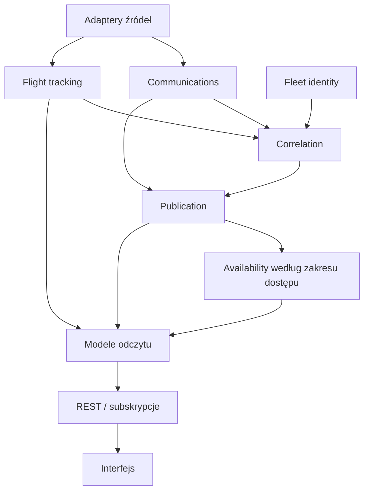

# Airframes Tracker — architektura v2

**Data:** 18 listopada 2026. **Status:** propozycja architektury i implementacja referencyjna wybranych reguł; nie gotowa platforma produkcyjna.
**Kontynuacja:** architektura v1 i makieta HTML uzgodnione w tej rozmowie.
**Priorytety:** SRP, jawne niezmienniki, małe moduły, kompozycja, kontrolowane zależności, możliwość poprawiania wcześniejszych decyzji.

## 1. Decyzja przewodnia

Pozostajemy przy modularnym monolicie TypeScript. Zwiększamy granulację **wewnątrz** granic domenowych: osobne typy wartości, reguły, przypadki użycia, porty i adaptery. Nie zwiększamy automatycznie liczby usług, kolejek ani pakietów npm. O rozdzieleniu procesu decydują zmierzone wymagania wykonawcze.

Przyjmujemy pięć poziomów struktury:

1. **Bounded context:** właściciel określonego modelu, języka i reguł; np. komunikacja lotnicza.
2. **Moduł odpowiedzialności:** spójna zdolność wewnątrz kontekstu; np. składanie fragmentów wiadomości.
3. **Przypadek użycia:** konkretny zamiar; np. `AcceptMessageFragment`.
4. **Czysta reguła / typ wartości:** jedna decyzja albo niezmiennik; np. `isWithinAssemblyWindow`.
5. **Adapter:** jedno połączenie ze światem; np. zapis sesji składania do PostgreSQL.

SRP oznacza wspólny powód zmiany, a nie obowiązek jednej klasy na instrukcję. Zmiana formatu dostawcy, polityki dopasowania i sposobu zapisu mają różnych właścicieli — dlatego trafiają do różnych plików. Podział na bounded contexts oraz takie rozumienie SRP opierają się na [S1] i [S2].

### Co konkretnie poprawiamy po v1

| Problem v1 | Decyzja v2 | Skutek w kodzie |
|---|---|---|
| Domeny, projekcje i transport nazwane równorzędnymi mikro-domenami | Osobno obszary biznesowe, aplikacyjne modele odczytu i platforma | Właściciel reguły jest jednoznaczny |
| `FlightCandidate` wymagany do każdego dopasowania | Osobne `AircraftLinkDecision` i `FlightLinkDecision` | Wiadomość można przypisać do maszyny bez znanej sesji lotu |
| `canonicalKey` sugeruje globalne usuwanie podobnych wiadomości | Trzy różne mechanizmy: idempotencja dostawy, grupowanie odbiorów, równoważność wiadomości | Kolejna rzeczywista transmisja nie znika tylko dlatego, że ma ten sam tekst |
| `Frame`, odbiór i zdekodowana treść mieszają znaczenia | `SourceDelivery`, `Reception`, `FrameOccurrence`, `MessageRevision` | Zachowujemy ścieżkę pochodzenia i wersję interpretacji |
| Jeden bearer i jeden protokół w spłaszczonym obiekcie | Wersjonowane drzewo/stos protokołów oraz kierunek komunikacji | VDL2 nie jest automatycznie traktowane jako ACARS |
| Decyzja miała wiele nullable ID | Rozłączne warianty wyniku | `MATCHED` bez `AircraftId` nie daje się zwyczajnie skonstruować |
| Aktualizacja last-seen wyłącznie przez `max()` | Rejestr aktywnych wkładów wiadomości i retrakcje | Zmiana dopasowania A→B poprawia status obu maszyn |
| Scheduler wygaśnięcia bez obrony przed starą pracą | `expectedRevision`, trwały termin i ponowne obliczenie | Stary timer nie wygasza świeżej wiadomości |
| Treść filtrowana, status i licznik potencjalnie z danych globalnych | Wkłady i projekcje ograniczone do uprawnionego odbiorcy | Brak ujawnienia samego istnienia niedostępnej wiadomości |
| REST snapshot i WS aktualizacje bez bariery | Snapshot + generation + cursor z tej samej projekcji | Brak cichej dziury przy starcie subskrypcji |
| Outbox potraktowany prawie jak broker | Osobne zadania fan-out, delivery i consumer inbox | Każdy konsument ma trwały, niezależny stan dostarczenia |

## 2. Osiem właścicieli reguł domenowych

To większe granice, w których mieści się wiele małych modułów. Integracje, modele odczytu i WebSocket pozostają osobnymi obszarami technicznymi.

| Kontekst | Własność modelu | Nie należy tutaj |
|---|---|---|
| `fleet-identity` | AircraftId, aliasy ICAO24/rejestracji, ich okresy ważności i pochodzenie | Bieżący lot i algorytm przypisania wiadomości |
| `flight-tracking` | Obserwacje pozycji, ślady, segmenty lotu, aktualna pozycja | Treść komunikacji i status ramek |
| `communications` | Dostawy danych, odbiory, ramki, składanie, rewizje wiadomości | Decyzja, do którego znanego samolotu przypisać wiadomość |
| `correlation` | Dowody i wersjonowane decyzje Message→Aircraft oraz Message→Flight | Dekodowanie radia, kolory mapy, SQL innych kontekstów |
| `availability` | Wkłady wiadomości w status odbioru i ich wygaśnięcie | Ocena źródeł po heurystyce mapy, zmiana tożsamości |
| `receiver-network` | Stacja, instalacja odbiornika, możliwości, heartbeat, lokalizacja | Zarządzanie hasłami użytkowników i sekretami dostawców |
| `publication` | Dopuszczalne pola, uprawniony zakres danych, rewizja polityki, wycofanie | Samo rozpoznawanie osób i logowanie |
| `access` | Principal, role/uprawnienia, token stacji, ważność dostępu | Treść wiadomości i lotnicze reguły publikacji |

Obszary techniczne:

- `source-connectors`: połączenia dostawców, schematy wejścia, retry, limity, deklaracje możliwości i kompletności feedu;
- `read-models`: map, flight-list, message-timeline, station-list, search; projekcje należą do aplikacji, nie do adaptera HTTP;
- `delivery`: subskrypcje, początkowa synchronizacja, delta, usuwanie obiektów z viewportu, backpressure;
- `platform`: outbox, durable dispatch, inbox, migracje, monitoring, zegar, identyfikatory, obiektowy magazyn payloadów.

**Granica transakcji nie jest granicą każdego pliku.** Odbiór i przypisanie go do wystąpienia ramki mogą wymagać jednej transakcji w `communications`, chociaż obsługują je różne małe komponenty. Rozbijanie tej operacji na usługi usunęłoby potrzebną atomowość.

## 3. Mapa zależności



Strzałka oznacza przepływ opublikowanych faktów albo jawny kontrakt odczytu. Nie oznacza prawa do importowania implementacji ani dostępu do cudzych tabel. `access` i `receiver-network` wspierają odpowiednie wejścia; nie są nadrzędnym serwisem wywoływanym przez każdą czystą regułę.

### Zależności wewnątrz kontekstu

`transport adapter → application use case → domain function`. Use case deklaruje port, adapter infrastruktury go implementuje. Composition root składa całość. Domain nie importuje Fastify, React, Kysely, Redis, SDK dostawcy ani systemowego zegara.

Zapytania synchroniczne przez publiczne interfejsy są dopuszczalne, jeżeli nie tworzą cykli i nie obchodzą własności danych. Zmiany między kontekstami są propagowane przez trwałe fakty. Szybkość wywołania lokalnej metody nie znosi granic architektury.

## 4. Słownik danych: czego nie wolno scalać

### 4.1 Samolot i lot

- `AircraftId`: stabilny identyfikator wewnętrzny; nie jest stringiem ICAO24.
- `AircraftIdentityAssertion`: twierdzenie źródła o identyfikatorze wraz z okresem obowiązywania i czasem zapisania.
- `PositionObservation`: fakt pozycji z czasem obserwacji, źródłem i typem pomiaru.
- `FlightSession`: hipoteza o konkretnym odcinku lotu, z historią zmian przypisania.
- `ObservedTrack`: zbiór rzeczywiście odebranych pozycji. Nie jest planem trasy.
- `PlannedRoute` / `ScheduledService`: opcjonalne, oddzielne dane; brak nie upoważnia do zgadywania celu z kierunku lotu.

Rejestr aliasów rozróżnia `validFrom/validUntil` od `recordedAt/supersededAt`. Nie musimy wdrażać pełnej bitemporalnej bazy na starcie, ale nie wolno nadpisywać historii istotnej dla korelacji. Bieżący alias nie musi być poprawnym aliasem starego odbioru.

### 4.2 Dostawa, odbiór, ramka i wiadomość

| Model | Tożsamość i znaczenie |
|---|---|
| `SourceDelivery` | Konkretne dostarczenie danych do integracji; dostawca może je powtórzyć po reconnect |
| `Reception` | Znany odbiór przez konkretny receiver/stację; wiele dostaw może relacjonować ten sam odbiór |
| `FrameOccurrence` | Hipoteza o jednej transmisji ramki widzianej przez wiele odbiorników |
| `FrameObservation` | Interpretacja jednej obserwacji ramki: payload, jakość, kierunek i wynik dekodowania |
| `AssemblySession` | Kontrolowany stan składania fragmentów jednego komunikatu |
| `LogicalMessage` | Wiadomość aplikacyjna, która może powstać z kilku fragmentów |
| `MessageRevision` | Niezmienna wersja zdekodowanej treści, z wersją dekodera i odniesieniami do dowodów |

Nie każdy dostawca udostępnia wszystkie te poziomy. Gdy otrzymujemy gotowy `Message`, zapisujemy `ProviderMessageObservation` z jego pochodzeniem. **Nie tworzymy fikcyjnej ramki ani fikcyjnej stacji**, aby wypełnić schemat. `dataLevel` opisuje rzeczywisty poziom danych, a brak raw payloadu pozostaje jawnym brakiem.

Reassembly wymaga identyfikacji fragmentów, kolejności i timeoutów; takie możliwości opisuje dokumentacja libacars [S3]. Istniejące dekodery VDL2 obsługują więcej niż ACARS [S4]. Korzystamy z adapterów do istniejących dekoderów, bez pisania własnego demodulatora radiowego w warstwie aplikacji webowej.

### 4.3 Protokół jako struktura

Przechowujemy `bearer`, `protocolStack` oraz `direction`. Kierunek: `AIR_TO_GROUND`, `GROUND_TO_AIR`, `UNKNOWN`. Tożsamość nadawcy nie jest automatycznie tożsamością samolotu: wiadomość uplink może być adresowana do maszyny. Parser wydobywa role adresów, a korelator używa właściwego uczestnika.

Nie ustanawiamy globalnego enumu, którego każda nowa aplikacja radiowa wymaga przebudowy całego systemu. Rdzeń ma stabilne kategorie, registry parserów ma wersjonowane rozszerzenia; nieznana gałąź protokołu nie jest dowolnym `any`.

## 5. Communications: podział według realnych powodów zmiany

Przepływ jednej dostawy:

1. `ValidateEnvelope`: rozmiar, schemat, wymagane metadane.
2. `ClassifyInputLevel`: raw frame, fragment, gotowa wiadomość dostawcy.
3. `NormalizeObservationTime`: czas, jednostki, źródło czasu i tolerancja zegara.
4. `ExtractSourceIdentity`: source, account, receiver, decoder, wersja.
5. `CheckDeliveryIdentity`: czy tę samą dostawę już przyjęliśmy.
6. `AppendReceptionFact`: zapis niezależnego odbioru, jeśli dostawca rzeczywiście go potwierdza.
7. `FindFrameOccurrenceCandidates`: wyszukiwanie podobnej transmisji w ograniczonym oknie.
8. `EvaluateFrameEquivalence`: zgodność adresów, sekwencji, częstotliwości, kierunku i czasu.
9. `AssignFrameOccurrence`: osobna, wersjonowana decyzja; zachowujemy źródłowe odbiory.
10. `DecodeFrame` lub `ImportDecodedMessage`: dwie różne ścieżki wejściowe.
11. `SelectAssemblyKey`: kontekst protokołu i sekwencji; nie sam hash tekstu.
12. `AcceptFragment` / `ExpireAssembly`: stan fragmentów, brakujące elementy i termin.
13. `FinalizeMessageRevision`: wersja wyniku z referencjami wejściowymi.
14. `CommitCommunicationFacts`: dane i outbox atomowo w danym use case.

To katalog odpowiedzialności, nie lista 14 brokerów i 14 sieciowych wywołań. Niezależne małe funkcje mogą być składane w jednym procesie i jednej transakcji. Szczegółowy katalog w `docs/MODULE_CATALOG.md`.

### Trzy różne pojęcia duplikatu

**Dostawa ponowiona:** ten sam `(source, account, stableExternalId)`, o ile stabilność ID jest potwierdzona kontraktem. Klucz uwzględnia zakres dostawcy, sesję lub receiver, jeżeli identyfikatory mogą się powtarzać. Sprzeczny payload pod tym samym kluczem jest błędem do rozpatrzenia.

**Wielokrotny odbiór jednej transmisji:** trzy odbiorniki słyszą ten sam frame. Zachowujemy trzy `Reception`, tworzymy jedno `FrameOccurrence` i trzy powiązania. Klucz fingerprint wyszukuje kandydatów, a nie gwarantuje równoważności.

**Podobne wiadomości:** dwa komunikaty mają identyczny tekst o różnym czasie lub sekwencji. Domyślnie są osobnymi faktami. Retransmisja, ponowiony ACK i reassembly mają reguły właściwe protokołowi. Grupowanie według samego tekstu może niszczyć historię.

Okna deduplikacji nie mogą zależeć wyłącznie od `floor(timestamp / interval)`: odbiory tego samego zdarzenia mogą leżeć po obu stronach granicy przedziału. Szukamy w sąsiednich bucketach i oceniamy rzeczywistą różnicę czasu. Operacja get-or-create wymaga ochrony przed konkurencyjnym utworzeniem dwóch wystąpień; adapter DB egzekwuje unikalność bezpiecznych kluczy lub blokadę właściwego shardu.

## 6. Korelacja: dwa procesy zamiast jednej wielkiej usługi

### 6.1 Message → Aircraft

Use case `ResolveMessageAircraft` przyjmuje identyfikator i rewizję wiadomości, pobiera dozwolone fakty, wydobywa znormalizowane wskazówki i pobiera kandydatów z lokalnej projekcji tożsamości. Brak sesji lotu nie blokuje tego etapu.

Małe reguły:

- `ValidateIcao24`: format i semantyka adresu, bez rzutowania dowolnego stringa;
- `NormalizeRegistration`: zachowuje oryginał i wynik normalizacji; nie usuwa arbitralnie znaków;
- `SelectAircraftAddressRole`: rozpoznaje adres statku powietrznego w uplink/downlink;
- `ResolveIdentityAtObservationTime`: wybiera alias ważny w chwili obserwacji;
- `CollectExactIcaoEvidence` i `CollectRegistrationEvidence`: niezależne dowody;
- `DetectStrongIdentifierConflict`: mocne sprzeczności nie są kompensowane innymi punktami;
- `ResolveCandidateUniqueness`: dwóch równie dobrych kandydatów daje `AMBIGUOUS`;
- `DecideAircraftLink`: jawna polityka decyzji, bez procentu pewności udawanego przez sumę wag;
- `BuildLinkRevision`: zapisuje wejściowe rewizje, policyVersion, dowody i identyfikator poprzedniej decyzji.

Wynik ma warianty `MATCHED`, `AMBIGUOUS`, `CONFLICTED`, `UNMATCHED`. Nieoznaczona niepełna próbka kandydatów nie pozwala ogłosić jednoznaczności. `CandidateSet` zawiera kompletność indeksu i checkpoint; timeout albo niegotowy indeks jest błędem/retry, a nie `UNMATCHED`.

### 6.2 Message → FlightSession

Osobny use case `ResolveMessageFlight` korzysta z zaakceptowanego dopasowania do samolotu oraz okna obserwacji. Jego reguły sprawdzają:

1. Czy sesja należy do już rozpoznanej maszyny.
2. Czy ważne okno lotu przecina przedział wiarygodnego czasu wiadomości.
3. Czy callsign pasuje do danej sesji i nie został znormalizowany przez zgadywanie.
4. Czy nie istnieje druga konkurencyjna sesja.
5. Czy jakość czasu jest wystarczająca do dokładnego przypisania.

Możliwy poprawny stan: `aircraft = MATCHED`, `flight = UNMATCHED`. UI pokazuje wiadomość przy maszynie, a nie dopisuje fałszywego numeru lotu. Stan „brak dopasowania” nie może udawać awarii dostawcy.

### 6.3 Uzasadnienie i rewizje

Każda decyzja przechowuje `messageRevision`, `identityIndexRevision`, `policyVersion`, dowody użyte i odrzucone oraz czas podjęcia decyzji. Re-evaluation emituje nową rewizję i informację o poprzednim przypisaniu. Nie nadpisujemy śladu poprzedniej decyzji.

Korelator nie składa fragmentów, nie wysyła WebSocketów i nie oblicza zielonej kropki. Może być dokładnie przetestowany na danych bez uruchamiania bazy.

## 7. Availability: status jako wynik odwracalnych wkładów

Samo `lastMessageAt = max(lastMessageAt, eventTime)` nie wystarcza. Po odkryciu, że ostatnia wiadomość należała do innego samolotu, potrzebujemy wcześniejszej prawidłowej wiadomości.

Wprowadzamy `MessageContribution`:

- klucz `(visibilityScope, messageId)`;
- własna, monotoniczna `contributionRevision`, nadawana przez właściciela publikowanego wkładu;
- `aircraftId`, opcjonalnie flightSessionId;
- bearer / applicationProtocol;
- właściwy czas zdarzenia oraz wiarygodność czasu;
- stan aktywny albo tombstone z rewizją.

Operacje:

`assignmentRevision`, `messageRevision` oraz rewizja grantu są niezależnymi wejściami producenta wkładu. Nie porównujemy ich liczbowo i nie bierzemy ich maksimum. Producent serializuje zmiany danego `(scope,messageId)` i nadaje osobny porządek `contributionRevision`; dzięki temu późniejsze cofnięcie grantu nie zostaje odrzucone jako „starsze” od przypisania z większą liczbą.

- `ApplyContribution`: nowa dozwolona wiadomość dodaje wkład;
- `ReplaceContribution`: rewizja przenosi wkład z A na B, wycofując poprzedni;
- `WithdrawContribution`: decyzja albo polityka usuwa wkład;
- `SelectLatestEligibleContribution`: wybiera maksimum z aktywnych, zgodnych z filtrem wkładów;
- `ComputeFreshness`: oblicza status z czasu i polityki;
- `ScheduleNextTransition`: wyznacza dokładny następny termin;
- `ExpireAvailability`: sprawdza expectedRevision i ponownie oblicza status;
- `RepairAvailability`: naprawia projekcję z faktów po awarii lub zmianie polityki.

Tombstone zapobiega przywróceniu wycofanego wkładu przez spóźnioną starszą rewizję. Jego retencja musi obejmować cały wspierany horyzont ponownych dostaw/replay; po skróceniu wymagamy nowej generacji projekcji i pełnego rebuild.

### Cztery niezależne osie

| Wymiar | Przykładowe wartości | Co wyświetla UI |
|---|---|---|
| Świeżość wiadomości | `RECENT / STALE / NONE` | Kolor statusu i ostatni czas |
| Dopasowanie | `MATCHED / AMBIGUOUS / CONFLICTED / UNMATCHED` | Opis dowodów albo ostrzeżenie o niepewności |
| Charakter feedu | `SAMPLED / STATION_SCOPED / UNKNOWN` | Znany zakres obserwacji |
| Zdrowie zasilania | `HEALTHY / DEGRADED / DISCONNECTED` | Problem odbioru danych |

Osobny stan opisuje jakość pozycji (`fresh/stale/unknown`) i rodzaj jej wyznaczenia. Świeża komunikacja nie odświeża starej pozycji ADS-B. „Częściowe” nie może jednocześnie oznaczać niepełnej wiadomości, próbkowanego feedu i słabego dopasowania.

Przyjmujemy do demonstracji półotwarte przedziały: `RECENT` dla wieku `[0,10 min)`, `STALE` dla `[10,60 min)`, `NONE` od 60 min. Wersjonowana polityka zapisuje dokładne granice. To decyzja projektowa, nie właściwość protokołów.

**Czas backfillu:** wiadomość zaobserwowana o 10:00 i zaimportowana o 12:00 nie robi się świeża o 12:00. `TimeEvidence` rozróżnia `observedAt`, `receiverAt`, `providerAt`, `ingestedAt`; adapter wskazuje podstawę i niepewność. Brak czasu obserwacji nie daje prawa do podstawienia `now` bez oznaczenia. Zbyt przyszłe timestampy trafiają do kontroli jakości.

Airframes rozróżnia próbkowany globalny stream oraz feed własnych stacji [S5]. Pełny feed jednej stacji nie oznacza pełnego pokrycia samolotu ani regionu. Nie wyliczamy procentu pokrycia z samej liczby ramek.

## 8. Publication przed publicznym statusem i wysyłką

Jednostką uprawnienia jest `VisibilityScope` (np. publiczny zbiór, konkretny właściciel stacji, uprawniona grupa), wraz z wersją polityki. RBAC i prawa do źródła mają odrębne role: to, że użytkownik jest zalogowany, nie oznacza prawa do wszystkich feedów.

`publication` emituje dozwolony wariant danych i wersjonowany grant/wkład. Publiczna mapa, publiczne liczniki i publiczna aktywność korzystają wyłącznie z tego wariantu. Nie wolno publikować liczby ukrytych wiadomości ani świeżości wyznaczonej z danych, których odbiorca nie powinien znać.

Przy cofnięciu dostępu:

1. `PublicationGrantRevoked` zmienia autorytatywną rewizję polityki.
2. `availability` wycofuje właściwe wkłady.
3. Projekcje usuwają wiadomość/licznik lub tworzą nową wersję widoku.
4. Gateway blokuje wysyłkę według nowej polityki, unieważnia buffer i stare cursory.
5. Klient otrzymuje remove albo `resync.required`.

Asynchroniczne odświeżenie projekcji może być opóźnione, dlatego sam projector nie jest jedyną ochroną uprawnień. Ostateczny odczyt i replay sprawdzają aktualny scope/policyVersion. Dane raz prawidłowo dostarczone do klienta nie dają się „odczytać z powrotem”; zmieniamy przyszłe dostępy i widoki.

## 9. Granice transakcji i niezawodność

### 9.1 Co jest atomowe

| Operacja | Jedna transakcja | Po transakcji |
|---|---|---|
| Przyjęcie odbioru | dedup dostawy + reception + link do frame + outbox | niezależne dekodowanie / reassembly |
| Zapis rewizji wiadomości | messageRevision + wejściowe referencje + outbox | korelacja, publication |
| Zmiana dopasowania | expectedRevision + decision + historia + outbox | aktualizacja uprawnionych wkładów |
| Konsumpcja zdarzenia | inbox konsumenta + jego lokalne efekty + nowy outbox | ACK / oznaczenie delivery |
| Przeniesienie wkładu | stary wkład + nowy wkład + status A i B + expiry + outbox | publikacja zmian obu maszyn |

Ostatnia operacja pozostaje lokalna w kontekście availability i danym visibilityScope. Przy późniejszym shardowaniu, gdy A i B trafią do różnych partycji, nie obiecujemy rozproszonej atomowości: wprowadzamy versioned replace/tombstone, stan pośredni i reconciler; preferowane partycjonowanie początkowe utrzymuje tę operację razem.

### 9.2 Port transakcyjny ograniczony do use case

Zamiast globalnego `UnitOfWork` udostępniającego dowolne tabele wprowadzamy capability-scoped transakcję, np. `CorrelationCommitter`, która może zapisać wyłącznie decyzję, jej wersję i zdarzenia. Use case nie otrzymuje surowego klienta SQL. Generyczna mechanika może obsługiwać transakcje, ale lista dostępnych operacji pozostaje typowana i wąska.

Nie łączymy `saveDecision()` i `eventBus.publish()` jako niezależnych kroków krytycznej ścieżki. Awaria między nimi nie może zgubić informacji o zmianie. Outbox jest wpisywany w transakcji decyzji.

### 9.3 Outbox, dispatch, inbox

W pierwszym deployu można użyć PostgreSQL do trwałej obsługi kolejki. Wtedy potrzebne są:

- niezmienny rekord outbox;
- trwały fan-out tworzący delivery dla każdego zarejestrowanego konsumenta;
- unikalność `(consumerId, eventId)`;
- claim/lease, liczba prób, termin retry i stan błędu;
- konsumencki inbox zapisany atomowo z lokalnymi efektami;
- mechanizm backfillu dla nowego konsumenta i przechowywanie zdarzeń do tego horyzontu.

**Nie używamy samego rosnącego ID jako bezpiecznego checkpointu zatwierdzeń.** Dwie transakcje mogą przydzielić ID w jednej kolejności, a zatwierdzić w drugiej. Dispatcher wyszukuje wszystkie niedostarczone rekordy, nie tylko `id > lastSeen`.

`FOR UPDATE SKIP LOCKED` jest użyteczne do claimowania pracy, lecz PostgreSQL zaznacza, że pomijanie blokad daje niespójny widok i służy m.in. kolejkom, nie ogólnemu snapshotowi danych [S6]. Trzymamy transakcje claimowania krótkie; nie otaczamy nimi długiej operacji sieciowej.

Po dodaniu JetStream transport zapewnia trwałe dostarczenia, ale adapter DB nadal musi być idempotentny. ACK po DB commit; ponowione eventId nie powtarza efektów. Mechanizmy deduplikacji brokera nie obejmują automatycznie transakcji naszej bazy [S7]. Wzorzec outbox i znaczenie aggregate key opisuje też Debezium [S8].

### 9.4 Kolejność i poprawki

Nie obiecujemy globalnego porządku wszystkich zdarzeń świata. Dla pojedynczego aggregate/stream obowiązuje monotoniczna `aggregateRevision`. Rozróżniamy eventy delta (wymagają kolejnych rewizji, luka wymaga backfill) od pełnego replacement state (może bezpiecznie zastąpić starszą wersję). Consumer nie zgaduje, który rodzaj otrzymał.

`schemaVersion` oznacza kształt DTO; `aggregateRevision` kolejność zmian; `policyVersion` algorytm; `projectionGeneration` wersję odbudowy widoku. Żadna z tych wartości nie zastępuje pozostałych.

## 10. Synchronizacja interfejsu bez luki REST→WS

Kontrakt subskrypcji zawiera `subscriptionId`, `generation`, `cursor`, fingerprint filtrów, visibilityScope oraz policyVersion. Cursory są opaque dla klienta. Nie przekazujemy sekwencji prywatnych zdarzeń jako publicznego licznika.

Proponowany protokół:

1. Klient wysyła `subscribe.viewport` albo `subscribe.aircraft`.
2. Gateway rejestruje odbiór zmian i rozpoczyna buforowanie dla tego zakresu.
3. Czyta snapshot i checkpoint **tej samej wersjonowanej projekcji** w spójnym widoku bazy.
4. Wysyła `snapshot.begin`, rekordy, `snapshot.end(cursor=C, generation=G)`.
5. Odtwarza z durable logu/bufora tylko zmiany po C, następnie przechodzi na live.
6. Po zerwaniu klient wraca z C i G; utrata retencji, zmiana uprawnień lub generacji wymusza nowy snapshot.

`MapProjectionWriter` zapisuje zmianę obiektu i wpis do swojego logu zmian atomowo. Porządek logu w MVP gwarantuje jeden writer / serializowany wiersz licznika dla shardu projekcji, nie sama sekwencja SQL. Przy shardach cursor staje się tokenem obejmującym wektor checkpointów albo stabilny wydzielony stream.

Delta ma rodzaj `upsert`, `remove`, `replace` albo `resync.required`. Samolot opuszczający bbox wymaga `remove`. Zmiana filtrów tworzy nową generację subskrypcji. Klient ignoruje spóźnione aktualizacje poprzedniej generacji.

Przeciążenie: pozycje można coalescować do ostatniej wersji samolotu; wiadomości podlegają trwałej paginacji i cursorowi, a overflow daje resync. Nie przekształcamy nieograniczonego bufora WS w przypadkową bazę danych.

## 11. Model trwały i odczytowy

| Właściciel | Najważniejsze tabele |
|---|---|
| fleet | aircraft, identity_assertions, alias_resolution_history |
| tracking | position_observations, current_position, session_revisions, session_observation_links |
| communications | source_deliveries, receptions, frame_occurrences, occurrence_links, assembly_sessions, message_revisions, message_inputs |
| correlation | aircraft_link_revisions, flight_link_revisions, current_message_links, candidate_index_checkpoint |
| publication | policy_revisions, message_visibility_grants, grant_revisions |
| availability | message_contributions, scope_aircraft_state, expiry_jobs, applied_revisions |
| receivers | stations, receiver_installations, capabilities, health_snapshots |
| application read | map_rows, map_change_log, message_timeline, station_cards, projection_generations |
| platform | context outbox, per-consumer inbox, deliveries, retries, quarantines |

Każdy kontekst posiada migracje i schemat. Wewnątrz kontekstu FK mogą wymuszać niezmienniki. Między kontekstami preferujemy identyfikatory i kontrakty, bez kaskadowego usuwania cudzych danych; rzadki cross-context FK wymaga ADR i świadomie ogranicza przyszłą separację.

PostGIS obsługuje przestrzenne filtrowanie pozycji. `observedAt` i `receivedAt` są osobne. Pozycja starsza nie nadpisuje nowszej; równe czasy mają jawny tie-breaker jakości i źródła. Redis jest opcjonalnym cache, nie warunkiem poprawności ani jedynym miejscem historii.

Payloady duże: immutable object storage, referencja + checksum + uprawnienia + retencja. Sekrety i signed URLs nie trafiają do domain events. Fakt odebrania pozostaje powiązany z prawdziwym źródłem; replay nie zmienia jego czasu.

Przykładowy projekt kluczowych tabel i transakcji jest w `persistence/REFERENCE_DDL.sql`. Nie został wykonany na produkcyjnej bazie ani poddany testom integracyjnym PostgreSQL; jest materiałem do implementacji adapterów.

## 12. Granulacja repozytorium

Docelowo:

```text
apps/
  api/                 # composition root REST, auth, serializacja
  ingest-worker/       # połączenia źródeł i intake
  processing-worker/   # decode, correlation, projekcje, expiry
  web/                 # routing i kompozycja UI
packages/
  fleet-identity/
  flight-tracking/
  communications/
  correlation/
  availability/
  receiver-network/
  publication/
  access/
  source-connectors/
  read-models/
  delivery/
  platform/
  kernel/
```

Procesy API i worker mogą na starcie współdzielić jeden artefakt wdrożeniowy. Każdy plik nie staje się paczką npm. Eksporty pakietów są małe, a wewnętrzne moduły mają własne entry pointy.

Przykładowy wycinek:

```text
correlation/
  src/
    aircraft-link/
      domain/
        values/aircraft-link-decision.ts
        evidence/icao24-evidence.ts
        evidence/registration-evidence.ts
        policies/reject-conflicting-identifiers.ts
        policies/choose-unique-candidate.ts
      application/
        resolve-message-aircraft.ts
        reevaluate-aircraft-link.ts
        ports/candidate-reader.ts
        ports/correlation-committer.ts
      infrastructure/
        postgres/pg-candidate-reader.ts
        postgres/pg-correlation-committer.ts
      public/index.ts
    flight-link/
      domain/policies/is-within-session-window.ts
      application/resolve-message-flight.ts
      public/index.ts
    reconciliation/
      application/reprocess-identity-range.ts
      public/index.ts
  contracts/
    aircraft-link-revised.v1.ts
    flight-link-revised.v1.ts
  composition/create-correlation.ts
```

Plik use case zawiera przebieg jednej operacji i przekazanie zależności. Nie jest „god class” tylko dlatego, że orkiestruje kilka kroków. Reguła domain jest najczęściej czystą funkcją. Klasa jest uzasadniona przy własnym stanie/lifecycle, np. połączeniu, schedulerze albo buforze.

## 13. Generyczność z ograniczeniami

Wspólny `kernel` powinien pozostawać mały. Trafiają tam mechanizmy niezależne od lotnictwa, o stabilnej semantyce.

| Wzorzec | Zastosowanie | Ograniczenie |
|---|---|---|
| `Brand<T, Name>` | Rozróżnienie ID i jednostek | Każda wartość przechodzi parser/konstruktor; brand nie waliduje runtime |
| `Result<T, E>` | Oczekiwane odmowy i nieprawidłowe wejście | Nie zamieniamy każdej usterki infrastruktury w domenowy `UNMATCHED` |
| `Rule<Input, Evidence>` | Polityki z identyczną semantyką ewaluacji | Osobna polityka dla samolotu, sesji i deduplikacji |
| `Parser<Raw, Canonical, Error>` | Mapowanie konkretnego schematu dostawcy | Wire JSON jest walidowany, nie propagowany jako `unknown` wszędzie |
| `EventEnvelope<Name, Payload>` | Znana nazwa wiąże się ze znanym payloadem | Runtime schema + wersjonowanie; nie sam string + generic |
| `Transaction<Capabilities>` | Atomowe operacje dozwolone danemu use case | Brak surowego SQL w application i dostępu do całego repo |
| `CursorPage<T>` | Wyniki paginacji | Cursor związany z zakresem i filtrem, nie liczba stron |
| `DataTable<Row>` | Wspólne renderowanie tabel | Reguły ramek i kolory nie trafiają do generycznej tabeli |

Nie używamy `BaseService<T>`, globalnego `GenericRepository<T>.save()` ani katalogu `shared/business`. Porty mają czasowniki domenowe: `appendReception`, `commitLinkRevision`, `replaceContribution`. Minimalne czytniki są dopuszczalne, jeśli rzeczywiście zachowują tę samą semantykę.

Zależność do zegara jest argumentem/portem. Domain nie używa `Date.now()`. Timestamp ma parser, nie tylko cast. `schemaVersion`, `policyVersion` i typy wiadomości publicznych nie są importowane ze środka encji domenowych.

## 14. SOLID i rzeczywiste egzekwowanie granic

- **SRP:** jeden właściciel decyzji i powód zmiany; osobna polityka, orkiestracja oraz I/O.
- **OCP:** dodanie adaptera albo parsera przez registry; semantyka nowego protokołu nadal wymaga świadomej decyzji, nie „plugin magic”.
- **LSP:** wszystkie implementacje portu mają identyczną semantykę braku wyniku, błędu, unikalności i atomowości. Test double nie może udawać gwarancji, których DB adapter nie oferuje.
- **ISP:** `CandidateReader` nie ma metod usuwania; commit port nie wystawia wyszukiwania wszystkich tabel.
- **DIP:** composition root wstrzykuje zależności; application nie pobiera ich z globalnego service locatora.

W CI:

1. strict TypeScript + `noUncheckedIndexedAccess`, `exactOptionalPropertyTypes`, `useUnknownInCatchVariables`.
2. Zakaz deep imports między kontekstami i modułami; public entry points.
3. Zakaz zależności domain→application/infrastructure/framework.
4. Zakaz cykli zależności i niekontrolowanych dynamic imports.
5. Osobne projekty TS dla web, backend i kontraktów; project references wspierają podział kompilacji, ale nie zastępują reguł importu [S9].
6. Testy kontraktów adapterów, migracji i przykładów wire payloadów.

Heurystyka review: funkcja istotnie przekraczająca 40–60 linii, moduł z wieloma zależnościami albo plik ponad 200 linii wymaga zastanowienia. To nie są mechaniczne zakazy; rozbicie spójnej reguły na sztuczne klasy bywa gorsze.

## 15. Frontend: ta sama dyscyplina, odrębny model prezentacji

Stały design system z makiety pozostaje wspólny dla mapy, listy i panelu. Feature code jest rozdzielony na:

| Feature | Małe odpowiedzialności |
|---|---|
| aircraft-map | viewport, marker style, position layer, selected track, pointer interaction |
| aircraft-selection | ID wyboru i synchronizacja z URL |
| message-timeline | paginacja, wiersz wiadomości, payload viewer, opis dopasowania |
| frame-status | kolor świeżości, opis coverage, problem zasilania |
| flight-filters | model filtrów, walidacja URL, serializacja query |
| realtime-session | handshake, generation, cursor, reducer delta, reconnect |
| receiver-stations | lista stacji, health badge, formularz udostępnienia |

Serwerowe dane trafiają do jednego cache po identyfikatorach i zakresach; UI nie trzyma drugiej niezależnej kopii tych samych lotów w mapie i tabeli. Stan wyboru może być w URL. Biblioteka mapy ma własny render state, ale nie staje się źródłem reguł biznesowych.

`applyMapDelta` jest czystym reducerem: sprawdza generation i rewizję, stosuje upsert/remove, zachowuje selection nawet przy utracie punktu, pokazując stan „poza widokiem / brak aktualnej pozycji”. API i WS korzystają z tych samych DTO. Wszystkie statusy mają etykietę tekstową; sam kolor nie niesie całej informacji.

## 16. Stack i wdrożenie — utrzymujemy kierunek

TypeScript, React + MapLibre, Fastify, PostgreSQL + PostGIS, ręczna kompozycja zależności, walidacja schematów na wejściach. Redis i NATS są opcjonalnymi adapterami włączanymi po określeniu potrzeby. Nie dodajemy kolejnego frameworka tylko do rozdzielenia plików.

Na starcie wystarczą procesy `api` i `worker` plus PostgreSQL. Worker może mieć oddzielne pule zadań intake/correlation/projection/expiry, z limitami i budżetami. Własne SDR-y wysyłają dane przez uwierzytelniony adapter feeder, a nie przez współdzielony klient DB.

Podział na osobne usługi jest uzasadniony, gdy np. ciężkie dekodowanie ogranicza latency API albo fan-out WebSocket wymaga niezależnego skalowania. Wtedy migrują kontrakty i dane właściciela — nie przypadkowy zbiór klas korzystający z cudzych tabel.

## 17. Testy skupione na ryzyku

Pełna macierz jest w `docs/FAILURE_MODES.md`. Najważniejsze przypadki:

- znany ICAO24, brak sesji → można rozpoznać Aircraft;
- callsign bez mocnego identyfikatora → brak fałszywego confirmed;
- dwa pasujące aliasy albo sprzeczne mocne dowody → ambiguity/conflict;
- stary alias nie pasuje do nowej daty; backfill sprawdza starą datę;
- powtórzona dostawa nie dubluje odbioru, ale inna stacja jest zachowana;
- identyczny tekst po godzinie pozostaje osobną transmisją;
- wiadomość składa się z fragmentów w innej kolejności albo wygasa niekompletna;
- druga wersja dopasowania przenosi ostatnią wiadomość A→B;
- stara wersja zdarzenia nie odtwarza tombstone;
- stary timer nie cofa nowej projekcji;
- 10 min i 60 min dokładnie odpowiadają zadeklarowanym granicom;
- crash po commit przed ACK nie dubluje skutku;
- luka snapshot/stream nie gubi rekordu;
- zmiana uprawnień usuwa payload, licznik i wkład w status;
- replay nie produkuje „nowych” świeżych zdarzeń tylko przez nowy ingestion time.

Testy unit są dla reguł, contract dla adapterów, integration dla transakcji/DB, E2E dla przepływu UI. Benchmarki i testy obciążeniowe mają konkretne parametry (region, liczba maszyn, tempo pozycji i ramek, użytkownicy), nie deklarację „obsłuży miliony”.

## 18. Plan następnej implementacji

| Iteracja | Zakres | Dowód zakończenia |
|---|---|---|
| A | Typed kernel, kontrakty, granice importów, fixtures, reference rules | Powtarzalne testy bez feedu |
| B | Jeden adapter pozycji i jeden poziom danych komunikacji | Zapis z prawdziwym pochodzeniem i czasem; kontrola retry |
| C | Aircraft correlation + aktualność z retrakcjami | Zweryfikowany zestaw przykładów i brak fałszywych dopasowań w tym zestawie |
| D | Scope-aware projekcja mapy i wiadomości + snapshot/delta | Reconnect, zmiana filtrów, revocation, brak luk |
| E | FlightSession correlation, reassembly tam gdzie potrzebne | Brak mylenia kolejnych lotów; odtwarzalność rewizji |
| F | Stacje, więcej providerów, cache/broker/partycje | Pomiary wskazują potrzebę i potwierdzają korzyść |

Referencyjny kod dołączony do tej iteracji dotyczy A i wybranych reguł C. Nie ma połączenia do realnych dostawców, serwera HTTP, gotowego dekodera SDR ani adaptera PostgreSQL. Pełna lista wykonanych sprawdzeń i ich ograniczeń znajduje się w `VERIFICATION.md`.

## 19. Źródła pierwotne i zakres twierdzeń

Powyższe nazwy modułów, granice, progi i protokoły synchronizacji to propozycje projektu. Źródła służą do sprawdzenia bazowych zasad i możliwości technologii, nie są dowodem gotowości tej aplikacji.

- **[S1]** Robert C. Martin, [The Single Responsibility Principle](https://blog.cleancoder.com/uncle-bob/2014/05/08/SingleReponsibilityPrinciple.html).
- **[S2]** Martin Fowler, [Bounded Context](https://martinfowler.com/bliki/BoundedContext.html).
- **[S3]** libacars, [API Reference — reassembly](https://github.com/szpajder/libacars/blob/master/doc/API_REFERENCE.md).
- **[S4]** dumpvdl2, [README i wspierane protokoły](https://github.com/szpajder/dumpvdl2).
- **[S5]** Airframes, [Realtime / Streaming](https://docs.airframes.io/api/realtime/).
- **[S6]** PostgreSQL, [SELECT — locking clauses](https://www.postgresql.org/docs/current/sql-select.html).
- **[S7]** NATS, [JetStream](https://docs.nats.io/concepts/jetstream) i [pull consumers](https://docs.nats.io/learn/jetstream/pull-consumers).
- **[S8]** Debezium, [Outbox Event Router](https://debezium.io/documentation/reference/stable/transformations/outbox-event-router.html).
- **[S9]** TypeScript, [Project References](https://www.typescriptlang.org/docs/handbook/project-references.html).
- **[S10]** Node.js, [Running TypeScript Natively](https://nodejs.org/learn/typescript/run-natively): uruchomienie z usunięciem typów nie jest sprawdzeniem typów.

Źródła sprawdzone 18 listopada 2026. Szczegóły dostępu/licencji providerów wymagają uzgodnienia dla faktycznie używanego konta i sposobu publikacji.
